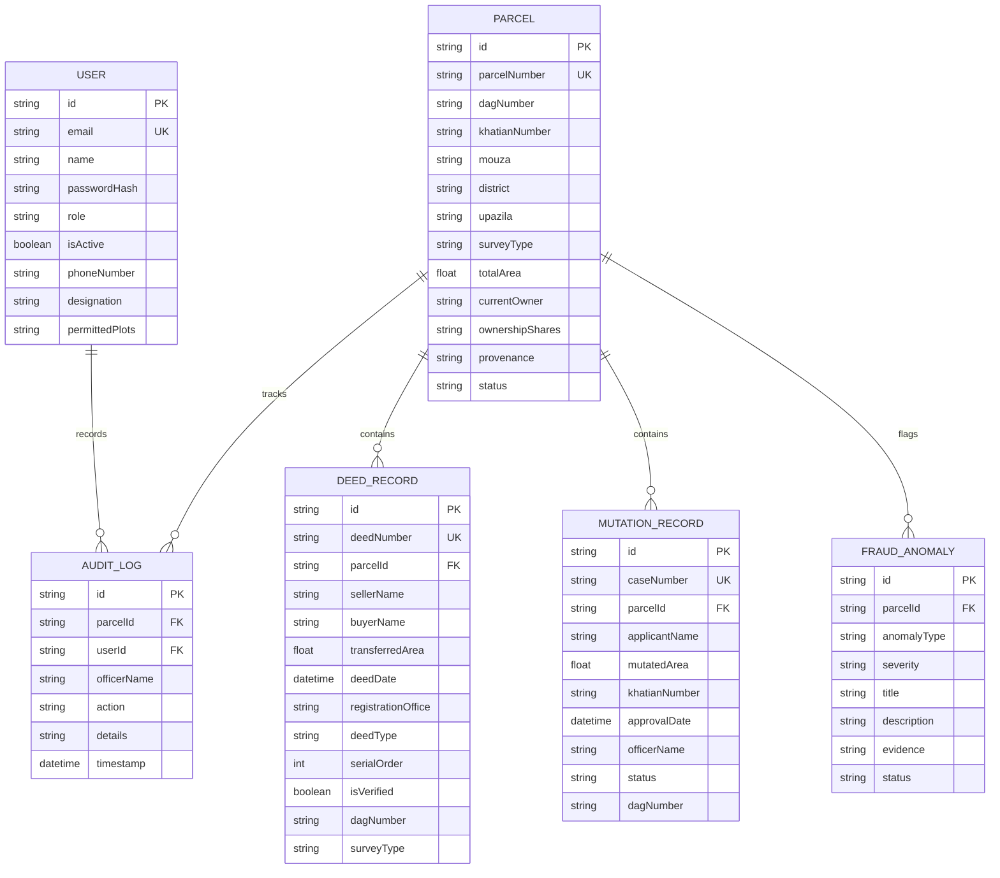

# LandTrace: Technical Architecture & System Design
## LandTech 2026 — Problem Statement P3: Fraud & Double-Selling Detection
### Team ID: LA-73

---

### 1. High-Level Architecture Overview

LandTrace is architected as an end-to-end cloud-native web platform utilizing a modular topological contradiction engine.

```text
┌────────────────────────────────────────────────────────┐
│            Presentation Layer (Bilingual UI)          │
│  - Citizen, Land Official, & Administrator Dashboards  │
│  - Dedicated Forensic Investigation Dossier View       │
│  - Natural বাংলা (Bangla default) / English Toggle     │
│  - Next.js 16 App Router + React 19 Client Components  │
│  - Tailwind CSS v4 Government-Style Light Theme        │
└───────────────────────────┬────────────────────────────┘
                            │
                            ▼
┌────────────────────────────────────────────────────────┐
│             Application & Business Logic Layer         │
│  - Server-Side Role Authorization (HMAC-SHA256 tokens) │
│  - Next.js Route Handlers & Server Actions             │
│  - Pure TypeScript Contradiction Detection Engine      │
│  - Pre-Registration Risk Simulation Service            │
└───────────────────────────┬────────────────────────────┘
                            │
                            ▼
┌────────────────────────────────────────────────────────┐
│               Data Persistence Layer                   │
│  - Prisma 6 ORM Client                                 │
│  - Neon Serverless PostgreSQL 16 (SSL Enforced)        │
│  - Relational Models: User, Parcel, Deed, Mutation,    │
│    Anomaly, and AuditLog                               │
└────────────────────────────────────────────────────────┘
```

---

### 2. Core Domain Data Model & Entity Relationships



---

### 3. Role-Based Access Control (RBAC) Architecture

| Role | Permitted Pages & APIs | Restricted Areas |
|---|---|---|
| **Citizen** | Search permitted parcel (`PLOT-DH-1001`), Pre-Registration Risk Check, view clean certificate | Cannot access officer investigation actions, internal dossiers of restricted plots, or admin dashboard |
| **Land Official** | Full parcel search, Dedicated Investigation Dossier, 5 Detection Rules, Officer Actions (Mark for Review, Field Inquiry, Notes, Forwarding), Print Dossier | Cannot manage user accounts or modify system roles |
| **Administrator** | All official features + User Management (`/api/admin/users`), account activation/deactivation, role promotion/demotion | System safeguards against self-deactivation |

---

### 4. Detection Engine Algorithmic Complexity

The detection engine (`src/lib/detection-engine.ts`) runs in polynomial time suitable for sub-second on-demand validation:
- **Double Selling**: $O(D \log D)$ sorting by deed execution date followed by sequential seller interest tracking.
- **Chain Break Verification**: $O(D)$ directed traversal over grantor/grantee legitimacy sets.
- **Area Conservation**: $O(D)$ cumulative summation and threshold bounding against parent khatian survey acreage.
- **Deed-Mutation Cross-Validation**: $O(M \cdot D)$ topological matching between AC-Land cases and Sub-Registry deed numbers.
- **Timing Anomaly Verification**: $O(D)$ pairwise temporal consistency checks.

---

### 5. Hosting & Continuous Integration

- **Code Repository**: GitHub (`RafiulKabir0/landtrace`)
- **Hosting Platform**: Vercel Serverless Platform
- **CI/CD Mechanism**: Git push to `main` automatically triggers production builds, static page pre-rendering, and asset distribution across Edge CDN nodes.
- **Production URL**: [https://landtrace.vercel.app](https://landtrace.vercel.app)

---

### 6. Team & Mentor Identification
- **Team ID**: `LA-73`
- **Team Members**: Rafiul Kabir (Team Leader, Dept. of Software Engineering, ID: `253-35-162`), Mst Maimuna Mim (Team Member, Dept. of Software Engineering, ID: `253-35-103`)
- **Faculty Mentor**: Ms. Subarna Akter Liza — Lecturer, Department of Computer Science & Engineering (CSE), `subarna.cse@diu.edu.bd` (Assigned by Organizing Committee)
- **Industry Support Mentor**: MD. Tahamid Hassan Sadib — CSE-TECH, `251-15-084@diu.edu.bd` (Assigned by Organizing Committee)
